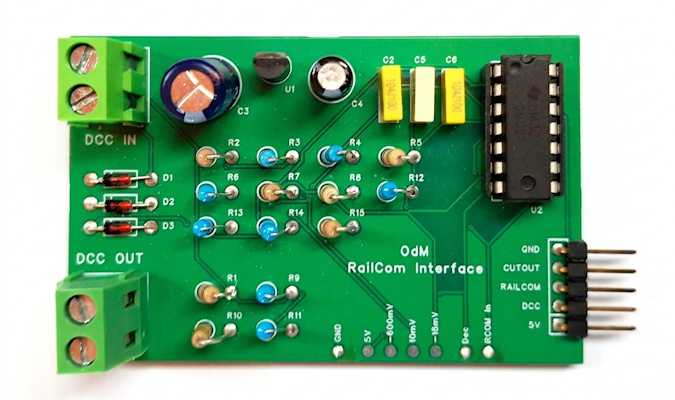
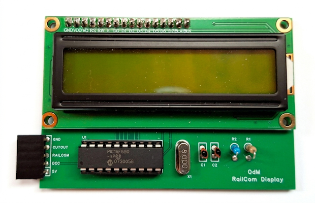

# RailCom

In this repository you can find my projects about RailCom (Bidirectional DCC).

> [!TIP]
> RailCom is the *commercial* name for NMRA's [Bidirectional DCC (S-9.3.2)](https://www.nmra.org/sites/default/files/standards/sandrp/DCC/S/s-9.3.2_bi-directional_communication.pdf)

## :movie_camera: Youtube Videos about RailCom
- [TBD](https://youtu.be/TBD)

## :arrow_right: RailCom Interface
> Interface that isolates and convert RailCom signals for a 5V microcontroller

- [Schematics](https://github.com/lucadentella/RailCom/blob/main/RailComInterface/schematics.pdf) (pdf)
- [Gerber files](https://github.com/lucadentella/RailCom/raw/main/RailComInterface/gerbers.zip) (zip)
- [Part list](https://github.com/lucadentella/RailCom/blob/main/RailComInterface/partlist.md) (md)

## :pager: RailCom Display
> Arduino-based device that receives and displays RailCom address

## :computer: Paco's RailCom Display
> Add-on to my RailCom interface based on [Paco's RailCom Display[(https://usuaris.tinet.cat/fmco/railcom_en.html)

- [Schematics](https://github.com/lucadentella/RailCom/blob/main/RPacoRCD/schematics.pdf) (pdf)
- [Gerber files](https://github.com/lucadentella/RailCom/raw/main/PacoRCD/gerbers.zip) (zip)
- [Part list](https://github.com/lucadentella/RailCom/blob/main/PacoRCD/partlist.md) (md)
- [firmware](https://usuaris.tinet.cat/fmco/download_en.html) (link to Paco's website)

## :bulb: RailCom Sensor

